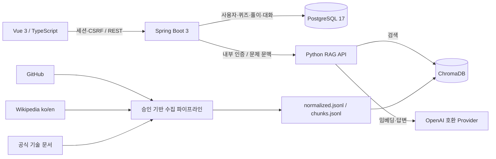

# CS/AS

> CS를 질문하고, 이해하고, 연결하다.
>
> CS를 공부하다 막히는 순간, AS해 드립니다.

CS/AS는 퀴즈를 푼 뒤 모르는 개념을 근거 기반 AI에게 질문하고, 관련 문제와 복습으로 학습을 이어가는 CS 학습 플랫폼입니다. 퀴즈와 챗봇을 별도 기능으로 끝내지 않고 **퀴즈 → 질문 → 이해 → 추가 퀴즈 → 복습**을 하나의 학습 문맥과 이력으로 연결하는 것이 목표입니다.

현재 인증, 검수 퀴즈 조회·채점, 사용자별 대화 저장·복원, Vector RAG, Vue 학습 화면, CS 문서 수집·정규화·증분 인덱싱과 검색 품질 평가까지 구현되어 있습니다. 승인된 실제 코퍼스와 평가를 거친 ACTIVE 인덱스를 Docker 전체 스택에서 사용합니다.

## 핵심 기능

| 영역 | 구현 내용 | 상태 |
|---|---|---|
| 인증 | 회원가입, 로그인, 로그아웃, 세션·CSRF, 사용자별 접근 제어 | 구현 |
| CS 퀴즈 | 분야/목록/상세 조회, 정답 비노출, 서버 채점, 풀이 시도 멱등 저장 | 구현 |
| 문제 연계 AS | 문제 문맥 RAG, 일반/퀴즈 대화 저장·목록·복원, 요청 멱등성과 실패 상태 | 구현 |
| Vector RAG | 구조 기반 청킹, 증분 Chroma 인덱스, 검색 근거·인용 검증, 20문항 품질 평가 | 구현 |
| 학습 UI | 랜딩, 인증, 계정, 퀴즈 풀이·결과, 문맥 AS 채팅·출처·이전 대화 복원 | 구현 |
| 데이터 수집 | GitHub, 한·영 Wikipedia, 공식 HTML/Markdown/RFC/sitemap 수집·정규화 | 구현·출처 승인 대기 |
| AI 관련 문제 | 검색 근거 기반 생성·독립 검증·개인 문제 저장 | 후속 |
| 복습·마이페이지 | 대화 복원 구현; 통계, 오답 상태와 재풀이는 후속 | 일부 구현 |
| Graph RAG | 개념 관계·근거 기반 지식 지도와 하이브리드 검색 | 2차 확장 |

## 동작 구조



- Spring Boot는 인증, 소유권, 채점, 학습 기록과 공개 API를 담당합니다.
- Python은 문서 수집, 인덱싱, 검색, 근거 기반 답변을 담당하며 사용자 계정 DB를 수정하지 않습니다.
- PostgreSQL은 서비스 데이터를, ChromaDB는 검색용 청크와 벡터를 저장합니다.
- 브라우저는 Python이나 데이터베이스에 직접 접근하지 않습니다.

## 기술 스택

| 계층 | 기술 |
|---|---|
| Frontend | Vue 3, TypeScript, Vite, Pinia, Vue Router, Vitest, Playwright |
| Backend | Java 21, Spring Boot 3.5, Spring Security, Spring Data JPA, Flyway, Gradle |
| AI/RAG | Python 3.11+, 구조 기반 청킹, OpenAI 호환 임베딩·답변 provider |
| Data | PostgreSQL 17, ChromaDB 1.5 |
| Quality | JUnit, 전용 PostgreSQL 통합 테스트, unittest, ESLint, Prettier, Checkstyle, Spotless, 공통 harness |

## 빠른 시작

### 요구 환경

- Docker Engine 및 Docker Compose v2
- 호스트 Python·Node.js·JDK는 기본 개발 실행에 필요하지 않습니다.

### 1. 환경 설정

```sh
cp .env.example .env
cp backend/.env.example backend/.env
```

루트 `.env`의 `POSTGRES_PASSWORD`를 로컬 개발용 값으로 지정하고, `backend/.env`의 `GMS_KEY`를 채웁니다. 실제 비밀값과 `.env` 파일은 커밋하지 않습니다. 루트 `.env`는 Compose/DB 설정, `backend/.env`는 GMS provider 설정으로 분리합니다.

### 2. 전체 개발 스택 실행

```sh
docker compose up -d --build --wait --wait-timeout 240
docker compose ps
```

브라우저에서 `http://localhost:5173`에 접속합니다. 기본 주소는 frontend `5173`, backend `8080`, 로컬 RAG `8090`, PostgreSQL `5432`, ChromaDB `8000`이며 모두 loopback에만 공개됩니다. 소스 변경 후 이미지를 갱신하려면 같은 명령을 다시 실행합니다.

로그와 종료 명령은 다음과 같습니다.

```sh
docker compose logs -f frontend backend ai
docker compose down
```

`down`은 PostgreSQL·Chroma named volume과 frontend/Gradle 캐시를 보존합니다. 데이터를 명시적으로 폐기하는 경우가 아니라면 `--volumes`를 사용하지 않습니다.

> 기본 `ai` 컨테이너는 `backend/.env`의 GMS Chat/Embedding을 실제 호출합니다. 현재 ACTIVE 인덱스 `csas-live-20261023-v5`는 승인된 36문서의 1,024청크를 `text-embedding-3-large` 3,072차원으로 구축했습니다. 외부 호출 없이 UI만 개발하려면 루트 `.env`에서 `RAG_DEV_PROVIDER=deterministic-test`, `RAG_ACTIVE_INDEX=local-dev-v1`을 사용합니다.

## 주요 API

| 기능 | 엔드포인트 |
|---|---|
| CSRF | `GET /api/v1/auth/csrf` |
| 회원가입 | `POST /api/v1/auth/signup` |
| 로그인·현재 사용자 | `POST /api/v1/auth/login`, `GET /api/v1/auth/me` |
| 퀴즈 | `GET /api/v1/quiz/categories`, `GET /api/v1/quizzes`, `GET /api/v1/quizzes/{quizId}` |
| 답안 제출 | `POST /api/v1/quizzes/{quizId}/attempts` |
| AS 대화 | `GET/POST /api/v1/chat/sessions`, `GET /api/v1/chat/sessions/{sessionId}/messages`, `POST /api/v1/chat/sessions/{sessionId}/messages` |

전체 요청·응답 계약은 [API 명세](docs/07_API_SPEC.md)와 [OpenAPI](docs/api/openapi.yaml)를 참고하세요.

## 데이터 수집과 RAG

수집 대상은 다음 세 종류입니다.

- `gyoogle/tech-interview-for-developer`의 검토된 CS Markdown
- 한국어 Wikipedia의 제한된 CS 문서와 category BFS(영어판은 승인 대기)
- 공식 기술 문서의 HTML, Markdown, RFC 텍스트 및 제한된 sitemap

OSSU는 현재 수집 대상과 등록부에서 제외되어 있으며 OSSU 과목·링크도 수집하지 않습니다. 출처는 `enabled=true`, `usage_review=approved`, 라이선스·저작자 표시·약관·robots 검토가 모두 충족되어야 본문을 수집할 수 있습니다. 현재 Gyoogle, 한국어 Wikipedia, RFC 9110, MDN HTTP, PostgreSQL 17의 5개 출처가 승인됐고 나머지 76개는 대기 상태입니다. 실코퍼스 36문서·1,024청크를 `csas-live-20261023-v5` ACTIVE 인덱스로 서비스합니다.

```sh
# 등록부 확인
python3 scripts/ingest.py list --all

# 네트워크·파일 쓰기 없는 정책 확인
python3 scripts/ingest.py collect --priority 0 --sample --dry-run

# 모의 fixture 수집
python3 backend/ai/tests/sample_ingestion.py --output /tmp/csas-ingestion-sample
```

Wikipedia 수집기는 category continuation, BFS 깊이·문서 상한, 제외 카테고리, 중복 제거와 SQLite 기반 이어받기를 지원합니다. 일시 오류에는 제한된 exponential backoff+jitter를 적용하고 `Retry-After`를 존중합니다.

승인된 JSONL을 인덱싱하는 흐름은 다음과 같습니다.

```sh
python3 scripts/rag_index.py \
  --index-version cs-v1 \
  --input data/processed/ingestion/normalized.jsonl \
  --ingestion-manifest data/processed/ingestion/manifest.json
```

인덱스는 먼저 `BUILDING` 상태로 생성됩니다. 최소 검색 평가를 통과한 결과를 `--activate-evaluation`로 명시해야 `ACTIVE`가 되며, 기존 인덱스를 검증 없이 덮어쓰거나 초기화하지 않습니다. 자세한 정책은 [수집 계약](docs/domain/ingestion.md)과 [RAG 가이드](docs/14_RAG_GUIDE.md)를 참고하세요.

## 검증

```sh
# 문서 구조, 설정, harness 회귀
python3 scripts/verify.py

# Spring Boot 포맷·정적 검사·단위/통합 테스트·jar
python scripts/backend.py check

# Vue 포맷·타입·lint·단위 테스트·빌드
python scripts/frontend.py check

# Python 수집·인덱싱·검색·답변 테스트
python3 -m unittest discover -s backend/ai/tests -p 'test_*.py' -v

# 브라우저 E2E
python scripts/frontend.py e2e
```

최근 C18~C20 기준 Python 테스트는 총 50개 중 49개가 통과했고, 실제 ChromaDB가 필요한 조건부 테스트 1개는 기본 실행에서 skip됩니다. Linux 공통 검증은 문서/내부 링크 309개, bootstrap 설정 17개, harness 19개를 통과했습니다. mock·fixture 성공을 실제 코퍼스 품질이나 외부 모델 성공으로 간주하지 않습니다.

## 프로젝트 구조

```text
CS-AS/
├── backend/
│   ├── src/                    # Spring Boot 인증·퀴즈·학습·대화
│   ├── ai/src/csas_rag/        # 수집·인덱싱·검색·답변
│   └── ai/tests/               # Python 단위·통합 계약 테스트
├── frontend/
│   ├── src/                    # Vue 앱과 도메인 UI
│   └── tests/                  # Vitest·Playwright
├── docs/
│   ├── api/                    # 공개 OpenAPI·내부 RAG 계약
│   ├── domain/                 # 수집·검색·답변·학습 도메인 계약
│   ├── decisions/              # ADR과 결정 이력
│   ├── exec-plans/             # 활성·완료 실행 계획과 검증 증거
│   └── runbooks/               # 실행·운영 절차
├── scripts/                    # 공통 개발·수집·인덱싱 진입점
├── harness/                    # 검증 정책·평가셋·실행 상태
├── compose.yaml                # frontend·backend·AI·PostgreSQL·ChromaDB 전체 개발 스택
└── compose.backend.yaml        # 이전 backend 전용 명령 호환 overlay
```

## 설계 원칙

- 정답과 채점 결과는 클라이언트나 AI가 아니라 서버가 결정합니다.
- 사용자 소유권과 문제·풀이 문맥은 서버에서 복원합니다.
- RAG 답변은 이번 요청에서 실제 검색된 청크만 인용할 수 있습니다.
- 근거 부족과 시스템 장애를 서로 다른 상태로 처리합니다.
- 수집 문서의 명령문은 실행 지시가 아닌 데이터로 취급합니다.
- 문서·리비전·청크·인덱스 버전을 보존하고 검증 전 데이터를 삭제하지 않습니다.
- 비밀번호, 세션, 이메일과 실제 비밀값을 모델 입력이나 공유 로그에 포함하지 않습니다.

## 로드맵

1. 출처별 라이선스·약관·robots 검토 및 제한된 실코퍼스 수집
2. 실제 임베딩·검색·인용 품질 평가와 ACTIVE 인덱스 전환
3. 대화 복원, 학습 통계, 오답노트와 재풀이
4. 검색 근거 기반 AI 관련 문제 생성·검증
5. 개념 관계와 근거를 보존하는 Graph RAG·지식 지도

현재 범위와 미완료 항목은 [현재 작업](docs/current-task.md), 단계별 기준은 [구현 계획](docs/10_IMPLEMENTATION_PLAN.md)에서 확인할 수 있습니다.

## 문서

- [프로젝트 제안서](docs/00_PROJECT_PROPOSAL.md)
- [제품 요구사항](docs/01_PRD.md)
- [아키텍처](docs/05_ARCHITECTURE.md)
- [ERD](docs/06_ERD.md)
- [API 명세](docs/07_API_SPEC.md)
- [테스트 시나리오](docs/09_TEST_SCENARIO.md)
- [개발 명령](docs/development.md)
- [전체 문서 지도](docs/README.md)

개발을 시작하기 전에는 [AGENTS.md](AGENTS.md)와 수정할 영역의 추가 지침을 먼저 확인하세요.
