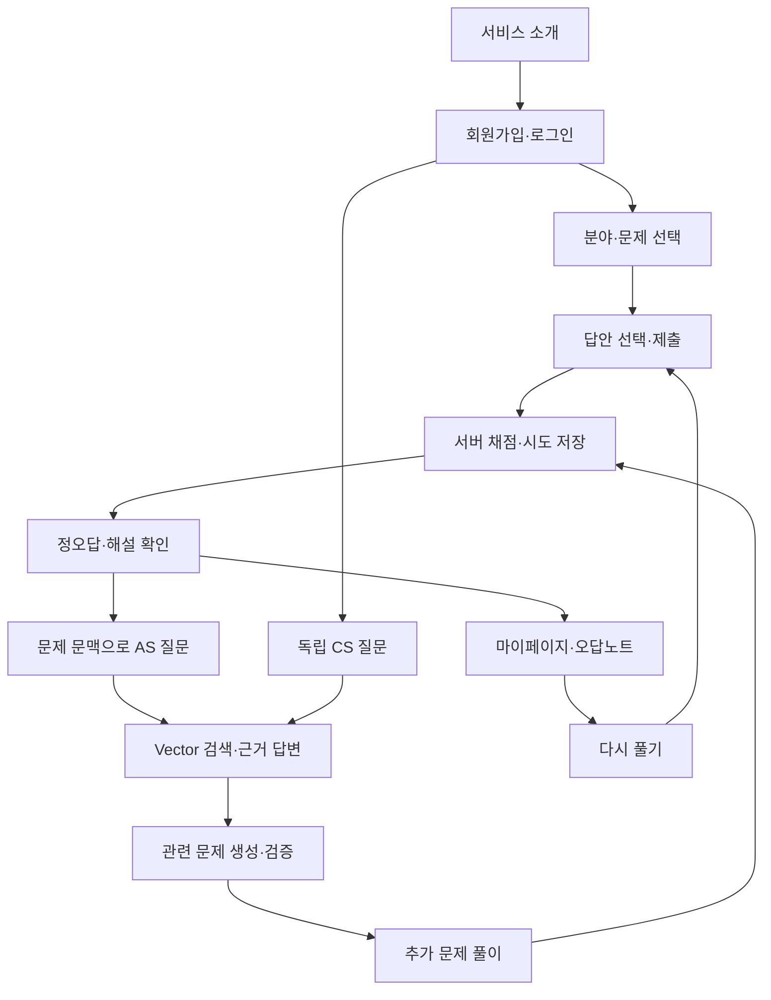

# 03. USER FLOW — 사용자 학습 흐름

상태: 1차 개발 설계 제안. 범위는 [MVP](02_MVP_SCOPE.md), 동작 정책은 [PRD](01_PRD.md)가 기준이다.

## UF-01 가입·로그인·첫 풀이

소개 → 가입 → 로그인 → 분야/난이도 선택 → 문제 선택 → 답안 제출 → 정오답·해설. 가입만으로 로그인되지 않는다. 인증되지 않은 학습 요청은 로그인 화면으로 유도하고 서버에서 401로 거부한다. 문제 조회에는 정답/해설이 없다.

## UF-02 문제에서 AS 질문

결과 화면의 AS 질문 → quiz_id/attempt_id로 세션 생성 → “왜 틀렸어?” → 서버가 본인 문제·선택·정오답·개념을 복원 → 검색 근거 답변·출처 표시. 재풀이해도 기존 대화 문맥은 이전 시도에 고정한다. 새 결과로 질문하려면 새 대화를 만든다.

## UF-03 독립 질문·관련 퀴즈

AS 새 대화 → CS 질문 → 답변·확인된 concept_ids → 관련 문제 생성 → 구조/독립 의미·근거 검증 → 개인 문제 → 제출·기록. 개념이 매핑되지 않았으면 자동 생성을 비활성화하고 기존 분야/문제의 개념 선택을 안내한다. 미검증 후보를 미리 보여주지 않는다.

## UF-04 오답 복습·재방문

마이페이지 → 오답 필터 → 과거 선택/정답/해설 → 다시 풀기 → 새 시도 저장 → 미복습/해결 상태 갱신. 새 풀이는 새 멱등 키를 사용하며 과거 오답은 보존한다. 로그아웃 후 재로그인해도 본인의 시도·대화를 복원한다.

## 공통 예외 흐름

| 조건 | 사용자 경험·재개 |
|---|---|
| 목록/이력 없음 | 빈 상태와 학습 시작 경로 표시 |
| 답안 통신 재시도 | 같은 키로 기존 결과 복원, 중복 시도 생성 방지 |
| 질문 근거 부족 | 답변 불가 상태와 질문 구체화 안내 |
| 검색/모델 장애 | 오류 표시. 기존 퀴즈와 복습은 계속 사용 |
| 메시지 응답 유실 | 대화 조회로 저장 여부 확인 후 수동 재시도 |
| 생성 검증 실패 | 문제 없이 실패 안내, 명시적 새 요청만 허용 |
| 세션 만료·타인 리소스 | 로그인 유도 또는 리소스 없음 표시 |

화면 상태는 [화면 명세](04_SCREEN_SPEC.md), 요청·오류·멱등성은 [API](07_API_SPEC.md), E2E 증거는 [테스트](09_TEST_SCENARIO.md)를 따른다. 지식 지도·관계 탐색은 2차다.
