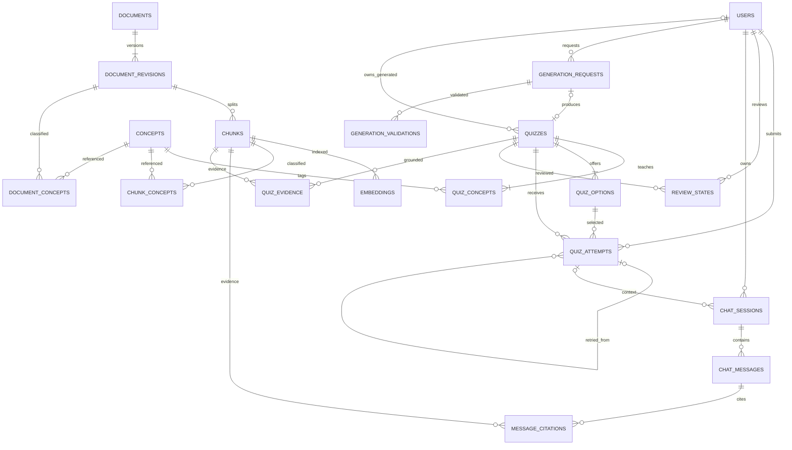

# 06. ERD — 데이터 모델과 관계

상태: users(V2), concepts·quizzes·quiz_options·quiz_concepts(V3), 검수 시드(V4), quiz_attempts(V5)는 구현했다. review_states와 대화·생성·검색 모델은 논리 설계 제안이다. 범위는 [PRD](01_PRD.md), API 표현은 [OpenAPI](api/openapi.yaml)가 기준이다.

현재 [수집 구현](domain/ingestion.md)은 불변 JSON 원본/정제본·청크와 로컬 SQLite 재개 catalog를 staging으로 사용한다. ChromaDB 검색 인덱스 적재 전 단계이며 서비스 데이터 저장소 결정을 변경하지 않는다.

## 저장소 책임

| 저장소 | 데이터 |
|---|---|
| PostgreSQL 서비스 스키마 | 사용자·개념·퀴즈/선택지·풀이·복습·대화·생성 검증 이력 |
| ChromaDB + 불변 파일 manifest | 문서 리비전·청크·임베딩·개념 연결·인덱스 manifest |
| 원본 파일 저장소 | source_id/document_id/revision별 원본·정제본, 해시·라이선스 |
| Graph DB (2차) | 공통 concept_id로 연결한 개념·검증된 관계·근거 투영 |

PostgreSQL과 ChromaDB를 별도 저장소로 분리한다. 문서·청크·벡터 행은 ChromaDB/manifest의 논리 모델이며 PostgreSQL migration 대상이 아니다. Vector DB가 채점·학습 이력의 원장이 되지 않는다. 원본 파일 본문을 서비스 테이블에 중복 저장하지 않는다.

## 1차 ERD

그림의 필수 4개 선택지·정답 수 같은 집계 제약은 아래 발행 검증으로 보완한다. 문서·청크와 concept_id의 저장소 간 FK는 논리 참조이며 수집 완료 manifest와 PostgreSQL 개념 원장으로 검증한다. Chroma 문서/메타데이터 및 불변 manifest가 아래 검색 엔터티를 표현한다. embedding_indexes는 파일 manifest의 인덱스 목록이며 별도 PostgreSQL RAG 테이블로 복제하지 않는다.

## 테이블 정의

기본 키는 UUID를 기본안으로 하되 `concept_id`는 안정된 문자열이다. 시간은 `timestamptz`/UTC, API는 ISO 8601이다.

| 테이블 | 주요 컬럼·키 | 제약·책임 |
|---|---|---|
| users | id UUID PK, email_normalized varchar(254), password_hash varchar(60), nickname varchar(40) nullable, created_at/updated_at timestamptz | email_normalized UNIQUE + lower/trim CHECK. BCrypt cost 12 CHECK. nickname 선택 입력, trim 후 1~40자. 암호 원문 저장 금지 |
| concepts | id PK, slug UNIQUE, name_ko, name_en, category, description, created_at/updated_at | 예: `concept:database-index`. 표시 이름 변경에도 ID 유지. V3 구현 |
| concept_aliases | alias_normalized, language, concept_id FK | (alias_normalized, language, concept_id) UNIQUE. 충돌 별칭은 자동 병합하지 않음 |
| quizzes | id PK, family_id, version, stem, category, difficulty, origin, status, owner_user_id FK?, explanation, source_url, reviewed_at, created_at/updated_at | (family_id, version) UNIQUE. origin=CURATED/AI_GENERATED, status=DRAFT/READY/RETIRED. V3 구현 |
| quiz_options | id PK, quiz_id FK, position, text, is_correct | (quiz_id, position) UNIQUE, (quiz_id, id) UNIQUE. 정답은 서버 전용. V3 구현 |
| quiz_concepts | quiz_id FK, concept_id FK, is_primary | 복합 PK, 대표 개념 1개와 추가 개념 허용. V3 구현 |
| quiz_attempts | id PK, user_id FK, quiz_id FK, selected_option_id, correct_option_id, is_correct, explanation/source URL snapshot, submitted_at, idempotency_key, request_hash, retry_of_attempt_id? | (user_id, idempotency_key) UNIQUE. 선택/정답 선택지와 문제의 복합 FK. V5 구현 |
| review_states | user_id FK, quiz_id FK, status, latest_attempt_id FK, last_reviewed_at? | (user_id, quiz_id) PK. NEEDS_REVIEW/RESOLVED |
| chat_sessions | id PK, user_id FK, context_attempt_id FK?, created_at | 문제 문맥은 본인 풀이만. 일반 대화는 문맥 null |
| chat_messages | id PK, session_id FK, role, content, status?, concept_ids, request_id, model_version?, index_version?, created_at | USER/ASSISTANT. answered/insufficient_evidence 상태. concept_ids는 원장 검증된 메시지 시점 스냅샷. 대화 순서는 created_at, id |
| message_citations | message_id FK, chunk_id, revision, index_version, ordinal | 원문 메타데이터 스냅샷(title/url/source_id/document_id/locator)을 보존 |
| generation_requests | id PK, user_id FK, concept_ids, session_id?, difficulty, idempotency_key, request_hash, status, quiz_id?, created_at | (user_id, idempotency_key) UNIQUE. GENERATING/VALIDATING/READY/REJECTED/FAILED |
| generation_validations | id PK, generation_request_id FK, validator_version, check_type, result, reason_codes, evidence_refs | 구조·독립 의미/근거 검증 이력. 후보 정답은 사용자에게 미노출 |
| quiz_evidence | quiz_id FK, chunk_id, revision, index_version, locator | 해설의 근거. 제출 전 읽기 API에서 제외 |
| documents | id PK, source_id, canonical_url, title | 출처 등록부 ID 참조, (source_id, canonical_url) UNIQUE |
| document_revisions | id PK, document_id FK, revision, content_hash, raw_uri, license, attribution, fetched_at | (document_id, revision) UNIQUE. 과거 인용 복원을 위해 덮어쓰지 않음 |
| document_concepts | document_revision_id FK, concept_id FK | 복합 PK. 문서 수준 검색 보조 |
| chunks | id PK, document_revision_id FK, ordinal, text, locator, chunk_config_version | (document_revision_id, chunk_config_version, ordinal) UNIQUE |
| chunk_concepts | chunk_id FK, concept_id FK | 복합 PK. 문서 태그를 모든 청크에 무조건 전파하지 않음 |
| embedding_indexes | version PK, model, dimensions, chunk_config_version, corpus_manifest, status | BUILDING/ACTIVE/RETIRED. ACTIVE 검증 후 전환 |
| embeddings | chunk_id FK, index_version FK, embedding float array | (chunk_id, index_version) PK. 모델 차원별 물리 저장소 분리 |

개념 연결 테이블은 모두 동일 `concepts.id`를 사용한다. API의 `concept_ids` 배열은 관계 테이블을 읽은 표현이다. 생성 요청의 배열은 요청 당시 입력 스냅샷이다.

## 채점·재시도·복습 트랜잭션

1. 세션 사용자·READY 상태·문제 접근권·선택지 소속을 확인한다.
2. `Idempotency-Key`를 사용자 범위에서 확인한다. 같은 키·같은 요청은 기존 결과를 반환하고, 다른 요청이면 409다. 동시 재시도는 UNIQUE 제약으로 직렬화한다.
3. 서버 정답으로 판정하고 `quiz_attempts`를 추가한다. LLM과 검색 DB를 호출하지 않는다.
4. 복습 상태를 잠그고 갱신한다. 첫 정답은 복습 행을 만들지 않고, 오답 또는 기존 복습 행이 있으면 상태를 갱신한다.
5. 커밋 후 정답·해설·시도 ID를 반환한다. 실패하면 시도와 복습 변경을 함께 롤백한다.

동일 문제 재풀이는 새 멱등 키를 쓰고 `retry_of_attempt_id`로 본인의 같은 문제 시도를 참조한다. 복습 행 경합은 (user_id, quiz_id) 잠금/upsert로 처리하며 커밋 순서를 최신 풀이로 정의한다. 정답률 계산은 quiz_attempts를 기준으로 하고, review_states는 조회용 상태다.

## 문제 발행·버전·접근 제약

- READY 전환 전에 선택지 4개·정답 정확히 1개·빈 내용 없음·중복 선택지 없음·대표 개념 1개·해설과 근거를 검증한다. 정답 최대 1개는 부분 UNIQUE 인덱스로, 최소 1개/정확히 4개는 발행 트랜잭션으로 보장한다.
- 발행한 문제·선택지·정답·해설은 수정하지 않는다. 수정은 새 quiz_id/version으로 발행하고 구버전을 RETIRED 처리한다. 과거 시도는 구버전을 계속 참조한다.
- RETIRED 문제의 과거 결과는 소유자가 조회할 수 있지만 새 시도는 409로 거부한다. 새 버전 복습으로의 자동 이전은 후속 기능이다.
- CURATED는 owner_user_id=null, AI_GENERATED는 소유자 필수이며 생성 검증 PASSED가 있어야 READY가 된다. 타인의 생성 문제는 404다.
- FK 대상의 학습 이력이 있으면 물리 삭제를 제한한다. “이력 보존”은 기본 동작이고 무기한 개인정보 보관 확정이 아니다. 실제 탈퇴·보존·익명화 정책은 배포 전 결정한다.

## 인덱스와 통계

quiz_attempts(user_id, submitted_at DESC, id), (user_id, quiz_id); review_states(user_id, status); quizzes(category, difficulty, status); chat_sessions(user_id, created_at); chat_messages(session_id, created_at, id); chunk_concepts(concept_id, chunk_id)를 기본 조회 인덱스로 제안한다. 벡터 인덱스 종류·검색 설정은 실제 코퍼스 평가 후 결정한다.

페이지 조회는 cursor 기반이다. 통계 total_attempts에는 재풀이가 포함되고 정확도는 correct_attempts / total_attempts다. 한 문제가 여러 개념에 연결되면 개념별 집계에 각각 포함되므로 개념별 수를 전체 풀이 수로 합산하지 않는다.

## Graph 확장

관계 모델은 [Graph RAG](domain/knowledge-graph.md)를 따른다. PostgreSQL concepts가 개념 식별자의 원장이고 Graph 노드는 그 ID의 투영이다. Graph 도입 시 quiz_attempts의 키를 교체하지 않는다. 관계·근거 변경은 버전 manifest와 재구축 가능한 배치로 반영한다.
