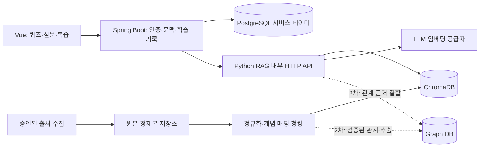
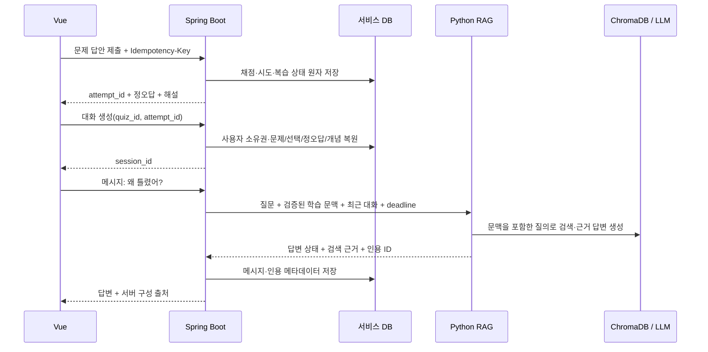

# 14. RAG GUIDE — Vector RAG·Graph 확장 가이드

상태: 1차 Vector RAG 코드 경로 구현 / 승인 코퍼스·모델 실평가 대기 / Graph RAG 2차. 제품 범위는 [ADR 0003](13_PHASE0_DECISIONS.md), 현재 기술 스택은 [ADR 0004](decisions/0004-stack.md), 데이터 키는 [ERD](06_ERD.md)가 기준이다.

## 1. 데이터 준비

1. [출처 등록부](data-sources.json)에서 승인·활성화된 출처만 수집한다. 현재 모두 비활성인 상태를 이 문서가 변경하지 않는다.
2. source_id/document_id/revision와 원문 URL·제목·위치·라이선스·저작자·해시를 보존한다.
3. 문서/청크에 검수한 `concept_ids`를 연결한다. 한·영 별칭은 concepts 원장에 매핑하고 불확실한 후보는 분리한다.
4. 청킹·임베딩 설정별 새 인덱스를 구축하고 중복 적재·검색 평가 후 ACTIVE로 전환한다.
5. 재수집은 동일 키를 upsert하며 기존 인용의 문서 리비전과 위치를 유지한다.

수집 세부 계약은 [ingestion](domain/ingestion.md), 실행은 [수집 안내](runbooks/ingestion.md)를 따른다. GitHub/한·영 Wikipedia/공식 HTML·Markdown·RFC·sitemap adapter와 원본·정제본·청크 staging, manifest가 구현되어 있다. OSSU는 수집 대상에서 제외했다. 81개 출처는 모두 pending·비활성이며 라이브 본문 수집은 미수행이다. 공식 문서 3개는 제한 URL까지 adapter-ready지만 승인은 아니다. 모의 샘플은 실제 코퍼스·검색 품질 증거와 구분한다.

C14~C16은 `normalized.jsonl`·`chunks.jsonl`, Markdown 구조 청킹, OpenAI 호환 임베딩/답변 공급자, 결정론 테스트 임베딩, 버전별 Chroma collection, BUILDING→평가→ACTIVE gate와 `/internal/v1/answers`를 구현했다. 결정론 임베딩은 테스트 전용이며 운영 인덱스에 사용하지 않는다.

## 2. 문제에서 질문까지

문맥은 quiz_id·문제/선택지·selected_option_id·선택 내용·is_correct·correct_option_id·해설·concept_ids·attempt_id다. 공개 요청은 ID만 받고, 서버가 소유권·문제 일치를 확인해 내부 요청을 구성한다. 사용자 이름/이메일/인증정보는 내부 RAG 입력에서 제외한다. 일반 질문은 quiz_context=null이다.

## 3. 검색과 응답

- 질의 재작성 시 “왜 틀렸어?”를 현재 문항의 구체적 개념 질문으로 바꾸되 원래 질문과 문맥을 보존한다.
- 개념 필터로 우선 검색하고 결과가 부족하면 분야/전체 코퍼스로 확장한다. 확장 검색의 개념 ID를 원래 학습 개념처럼 덮어쓰지 않는다.
- 문서 리비전·언어·인덱스 버전을 확인한다. Top-K·선택 청크 수·입력 토큰 예산은 평가로 고정한다.
- 빈 결과와 관련성 부족은 `insufficient_evidence`; 저장소/모델 장애는 502, deadline 초과는 504다.
- 생성기는 검색 청크만 사실 근거로 사용한다. 대화 이력과 문제 해설은 질문 이해용이며 별도 검색 없이 인용 근거가 되지 않는다.
- 인용 chunk_id가 이번 요청에서 검색·제공된 청크인지 검사한다. URL은 검색 메타데이터에서 구성한다. 위조/관련 없는 인용은 사용자에게 정상 답변으로 노출하지 않는다.
- 주장과 근거가 충돌하면 단정하지 않고 버전 차이를 설명하거나 근거 부족을 반환한다.

## 4. AI 관련 퀴즈

생성도 같은 검색기·개념 원장을 사용한다. 검색 → 후보 JSON → 구조 검사 → 독립 의미/근거 검사 → 저장 → 정답을 제외한 문제 DTO 순서다. 1차는 요청당 1문제다. 검색 결과가 없거나 검증이 실패하면 문제를 제공하지 않는다. 검증 이력·모델/프롬프트/인덱스 버전을 보존한다. 상세는 [생성 도메인](domain/quiz-generation.md).

## 5. 내부 경계와 장애

Spring Boot가 사용자 접근·문제 소유권·채점·서비스 DB 쓰기를 담당한다. Python은 검색·생성·검증만 담당하고 사용자 계정이나 풀이 테이블을 수정하지 않는다. 내부 API는 외부 라우팅에서 차단하고 서비스 인증을 적용한다. 외부 공급자 자격증명은 승인된 런타임 공급 경로로만 주입한다.

동기 응답을 1차 기본안으로 삼는다. 공개/내부 deadline을 전파하고 재시도는 남은 시간 안의 제한된 일시적 네트워크 오류만 허용한다. 생성 POST는 Spring의 요청 레코드/멱등 키로 제어한다. timeout 후 중복 과금·중복 문항을 방지할 정책은 구현 계약 검사에 포함한다. SSE·작업 큐·공유 캐시는 후속이며 개인정보가 섞인 응답을 사용자 간 공유하지 않는다.

Python 장애 시 기존 문제·해설·이력은 계속 제공한다. RAG 실패를 근거 부족으로 위장하지 않는다. 응답 생성 후 서비스 DB 저장이 실패하면 대화 저장 실패로 반환하며 저장되지 않은 대화를 저장 성공처럼 안내하지 않는다.

## 6. Graph 확장 지점

`Retriever`는 검색 결과와 근거 메타데이터를 반환하는 경계다. 1차 `VectorRetriever`, 2차 `HybridRetriever(VectorRetriever, GraphRetriever)`를 둔다. Graph에서 찾은 관계도 원문 청크 근거가 있어야 답변에 쓴다. 초기 구조에 빈 Neo4j 연결·실행 의존성을 추가하지 않는다. [관계 의미와 검증](domain/knowledge-graph.md)을 먼저 확정한다.

## 검증 증거

코드 버전·코퍼스 manifest·개념 매핑 버전·프롬프트/모델·임베딩 차원·인덱스 버전·검증기 버전을 함께 기록한다. 검색 평가, 인용 검증, 대표 답변 사람 검토, 학습 루프 E2E는 서로 대체하지 않는다. 기준은 [testing](09_TEST_SCENARIO.md), 내부 필드는 [RAG API](api/internal-rag.md)를 따른다.
