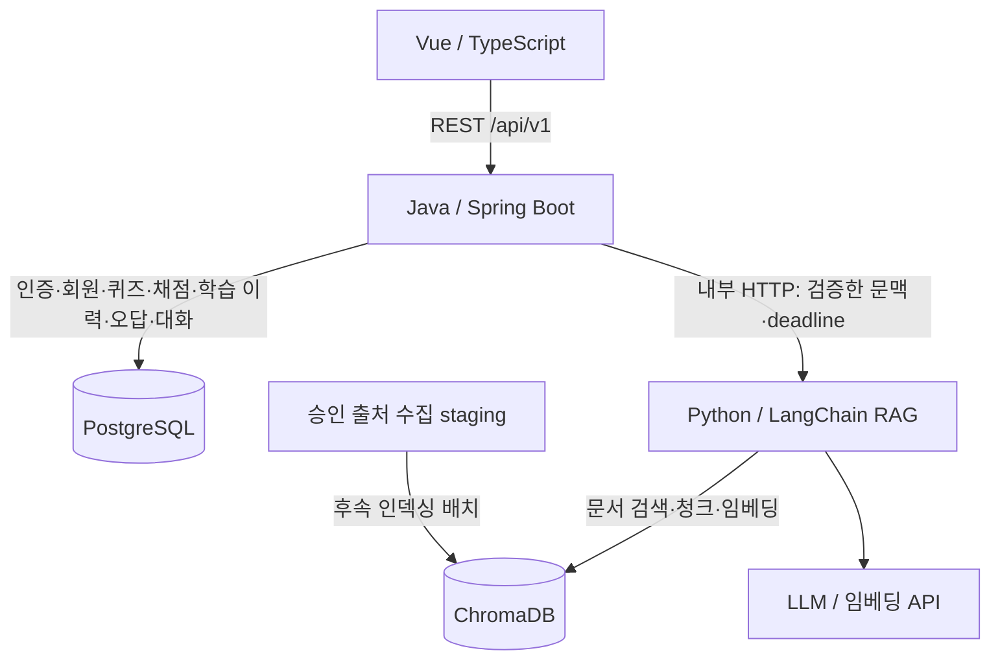

# MVP 아키텍처와 API 규칙 (C02)

상태: 2026-10-21 결정 채택. C04~C07에서 Java migration·health·사용자 인증을 구현했으며 학습 서비스는 후속이다. [구조 기준](05_ARCHITECTURE.md), [스택 ADR](decisions/0004-stack.md), [API 계약](api/openapi.yaml)을 함께 따른다. 기존 ADR 0001과 번호가 충돌하므로 요청된 `0001-stack.md` 대신 0004를 사용한다.

## 서비스와 데이터 흐름



Vue는 가입·로그인·퀴즈 풀이·대화·마이페이지·오답 화면을 제공하며 Spring 공개 API만 호출한다. Spring은 인증/인가, 회원 관리, 서버 채점, 멱등 제출, 학습 기록·복습·대화 세션 저장, Python 호출과 오류 변환을 담당한다. Python은 수집·전처리, 검색, 임베딩, 근거 답변, 퀴즈 후보 생성·검증을 담당한다. 생성된 문제의 최종 소유권 검사·발행·저장은 Spring 책임이다.

PostgreSQL은 사용자·퀴즈·풀이·복습·대화 메타데이터·개념 ID의 원장이다. ChromaDB는 검색용 청크 본문·벡터·출처/리비전/위치 메타데이터를 관리한다. 원본과 불변 manifest는 파일 staging에 보존한다. 인용·생성 근거는 PostgreSQL에 참조와 당시 출처 스냅샷만 저장한다. 검색 본문/임베딩을 양쪽 DB에 중복 원장으로 저장하지 않는다. 저장소 간 FK·분산 트랜잭션은 없으며 manifest와 안정된 ID로 일치 여부를 검증한다. Chroma 장애 중에도 기존 퀴즈 채점·해설·학습 기록 조회는 가능해야 한다.

## REST 규칙

경로와 필드명은 기존 [API 명세](07_API_SPEC.md)를 유지한다. `/api/v1/auth`, `/quizzes`, `/chat/sessions`, `/quiz-generations`, `/me/attempts`, `/me/wrong-answers`, `/me/stats`를 사용한다. 예시용 `/users`, `/quiz-attempts`, `/learning` 별칭을 새로 만들지 않는다. 리소스는 복수 명사·소문자·하이픈, GET은 조회, POST는 생성/상태 변경이다. 미지원 PUT/PATCH/DELETE는 구현 후 계약에 추가한다. GET에 상태 변경을 넣지 않는다.

공통 오류는 기존 `request_id`, `code`, `message`에 UTC `timestamp`를 추가한다. `request_id`가 요청 추적 식별자이므로 별도 `traceId`를 중복 도입하지 않는다. Spring 전역 예외 처리와 Security 인증/접근 거부 처리기가 같은 DTO를 반환하도록 구현한다. 내부 예외·SQL·자격증명은 응답에 넣지 않는다.

```json
{"request_id":"request-example","code":"QUIZ_NOT_FOUND","message":"해당 퀴즈를 찾을 수 없습니다.","timestamp":"2026-10-21T12:00:00Z"}
```

| HTTP | 기준 / 서비스 코드 예시 |
|---|---|
| 400 | 파싱·형식·필드 검증 실패 / INVALID_INPUT |
| 401 | 세션 없음·만료 / AUTH_REQUIRED |
| 403 | CSRF 실패·역할 권한 부족 / CSRF_INVALID, ACCESS_DENIED |
| 404 | 리소스 없음 또는 타인 개인 리소스 / RESOURCE_NOT_FOUND, QUIZ_NOT_FOUND |
| 409 | 중복 이메일·멱등 키 충돌·폐기 문제 / IDEMPOTENCY_CONFLICT |
| 422 | 형식은 유효하나 처리 불가능한 의미 입력 / UNPROCESSABLE_REQUEST |
| 429 | 사용자/서비스 호출 제한 / RATE_LIMITED, Retry-After |
| 500 | 내부 오류·서비스 DB 저장 실패 / INTERNAL_ERROR |
| 502 | 내부 AI·공급자 실패 또는 잘못된 응답 / RAG_UPSTREAM_FAILED |
| 503 | 점검·일시적 처리 불가 / SERVICE_UNAVAILABLE, Retry-After |
| 504 | 내부 AI·공급자 deadline 초과 / RAG_TIMEOUT |

422·503은 공통 예약 규칙이며 현재 경로에 반환 동작을 추가하는 것은 후속 계약 변경이다. 근거 부족·생성 검증 실패는 기존대로 200의 도메인 상태다. 존재하는 입력 검증 400을 임의로 422로 바꾸지 않는다.

## 인증·보안 결정

Spring Security + 서버 쿠키 세션을 채택한다. 단일 Spring MVP에서는 메모리 세션을 사용하며 재시작 시 재로그인한다. 유휴 30분·최대 수명 12시간을 적용하고 로그인 시 세션 회전, 로그아웃 시 무효화한다. 확장은 공유 세션 저장소 ADR로 다룬다. 비밀번호는 BCrypt cost 12로 해시한다. BCrypt의 72바이트 한계를 넘는 UTF-8 입력은 가입·로그인 모두 400으로 거부하며 조용히 자르지 않는다. 문자 길이 12~128 제약과 바이트 상한을 함께 적용한다. 해시·인증 동작은 후속 구현에서 검사한다.

쿠키는 CSAS_SESSION, HttpOnly·Secure·SameSite=Lax다. 로컬 HTTP 프로필에만 Secure=false를 허용한다. GET `/auth/csrf`로 토큰을 받고 가입·로그인을 포함한 모든 POST의 X-CSRF-Token을 검증한다. 로그인·로그아웃 뒤 토큰을 재조회한다. 익명 허용은 가입·로그인·CSRF와 소개 화면이며 나머지 학습 API는 인증 필수다. 사용자 ID는 세션에서 얻고 모든 개인 리소스 조회/변경을 소유자로 제한한다. 타인 기록·오답·대화·생성 문제는 404다.

동일 출처 프록시를 기본으로 CORS를 열지 않는다. 개발 중 분리 출처가 필요하면 `http://localhost:5173`만 credentials와 함께 허용하고 와일드카드는 사용하지 않는다. Python은 공개 ingress를 두지 않고 Spring만 내부 API에 접근한다. 서비스 Bearer 토큰을 런타임으로 주입·검증하며 사용자 쿠키를 전달하지 않는다. Chroma는 개발 호스트 loopback에만 공개하고 컨테이너에서는 전용 Compose 네트워크를 사용한다. 운영 인증·TLS·네트워크 정책은 배포 작업에서 결정한다.
