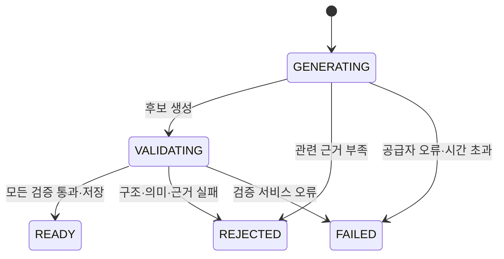

# 근거 기반 AI 퀴즈 생성

상태: 1차 개발 설계 제안. FR-08. 실시간 생성의 정확성을 형식 검사만으로 보장하지 않는다.

C25: 내부 quiz-candidates 경로와 QuizService를 구현했다. 기존 VectorRetriever와 GMS JSON provider를 재사용해 한 후보를 생성하며 개념·학습 문맥·실제 evidence·모델/프롬프트/인덱스/corpus 버전을 추적한다. 검증기 미설정 상태에서는 후보를 반환하지 않는다. LLM 자동 재생성 없이 단계별 deadline을 검사한다.

## 입출력·소유권

입력은 `concept_ids`, 선택적 `chat_session_id`, `difficulty`다. 사용자의 본인 대화만 참조한다. 대화가 있으면 현재 문제 개념·최근 학습 내용을 참고하되, 문제의 사실 근거는 새로 검색한다. `concept_ids`는 등록된 ID여야 하며 대화 내 개념과의 연결은 서버가 확인한다.

1차는 4지선다 단일 정답 1문항이다. 내부 후보는 stem/options/correct_option_position/explanation/concept_ids/evidence_chunk_ids를 가진다. 공개 응답은 저장된 Quiz DTO이며 정답·해설·근거를 제출 전 제외한다. AI 생성 표시와 개인 문제임을 안내한다.

독립 챗봇의 경우 Answer.concept_ids를 사용한다. 맨 앞 concept_id를 대표 개념으로 삼고 해당 개념의 domain에서 category를 결정한다. LLM이 임의의 카테고리/개념을 새로 만들지 않는다. 대화와 함께 요청한 ID는 대화에서 서버가 확인한 개념 집합에 포함돼야 한다.

## 상태와 발행

READY 전환과 개인 퀴즈·선택지·근거 저장은 하나의 트랜잭션이다. 사용자에게 초안/REJECTED 후보를 읽는 API를 제공하지 않는다. 자동 재생성은 최초 구현에서는 하지 않으며, 새 키로 명시적 재요청한다. 같은 멱등 키는 기존 생성 결과를 반환하고, 처리 중이면 409 `GENERATION_IN_PROGRESS`다. 실패 후 같은 키는 같은 실패 결과를 반환한다.

## 검증 파이프라인

| 단계 | 검사 | 실패 처리 |
|---|---|---|
| 검색 근거 | 실제 CS 근거·개념 관련성·유효 인용 ID | insufficient_evidence, 문항 없음 |
| 구조 | JSON 스키마, 선택지 4개, 정답 위치 1개, 내용 길이·빈값 | validation_failed |
| 결정적 규칙 | 선택지 중복, 개념 ID 존재, 정답/해설 누락, 검색 밖 인용 | validation_failed |
| 독립 검증 | 후보 생성과 분리된 검증 호출이 원문으로 직접 풀고 정답·오답 선택지·해설·근거 일치를 평가 | 불일치/모호함/불확실이면 validation_failed |
| 저장 전 검증 | 난이도·기존 문제와 중복·소유권·발행 제약 | validation_failed 또는 내부 오류 |

검증기는 후보 정답을 그대로 추인하지 않도록 먼저 정답을 보지 않고 풀이한 뒤 비교한다. 별도 모델 사용 여부는 비용·품질 평가로 결정한다. 독립 호출도 동일한 모델의 오류를 반복할 수 있으므로 출시 전 검수 표본이 필요하다. API에는 “AI 생성”을 표시하고 검증 통과를 사실 정확성 보증처럼 표현하지 않는다.

## 평가·추적

생성/검증 프롬프트·모델·인덱스·개념 매핑 버전과 체크 결과·실패 사유를 기록한다. 사용자에게 내부 추론이나 비밀정보를 노출하지 않는다. 고정 근거 fixture에는 정상 문항, 정답 2개, 모두 오답, 해설 모순, 존재하지 않는 인용, 공격 문서 사례를 포함한다.

실제 코퍼스의 최소 20개 생성 표본을 사람이 검토하는 출시 제안을 [testing](../09_TEST_SCENARIO.md)에 둔다. 발견된 오답 후보는 발행을 막고 회귀 fixture로 추가한다. 정책 확정과 실제 검토 증거 없이 “생성 퀴즈 검증 완료”로 보고하지 않는다.

공용 문제은행 편입·관리자 검수 UI·여러 문항 생성·주관식은 후속이다. Graph 단계에서는 관계 타입과 양 끝 concept_id·관계 근거를 입력에 추가하고 동일 발행 파이프라인을 재사용한다.
